# Getting started: signing in, two-step and your devices

## Your first sign-in

*Purpose: get into Steady for the first time with the temporary password the practice gave you.*

OpenWorks IT sets up the master psychologist's account. The master psychologist (or OpenWorks IT) sets up everyone else's, and gives each person a temporary password by phone or in person.

1. Open Steady. The first time, it shows **Your privacy**. Read it and tap **I understand**.

   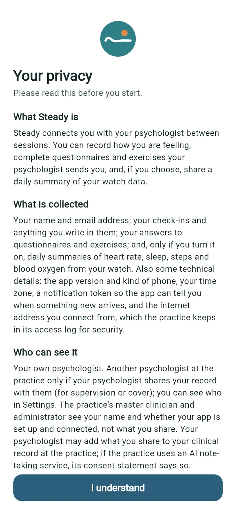

2. Type your **Email** and the temporary **Password**, then tap **Sign in**.

   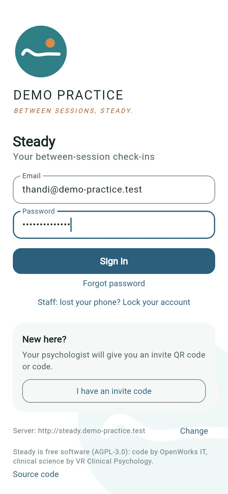

3. Steady shows **Link this browser** (or **Link this phone**) and emails you a 6-digit code. Type it in **Code from the email** and tap **Link and sign in**. The code works for 15 minutes. If it doesn't arrive, check your spam folder, or tap **No email? Check spam, or start again for a new code**.

   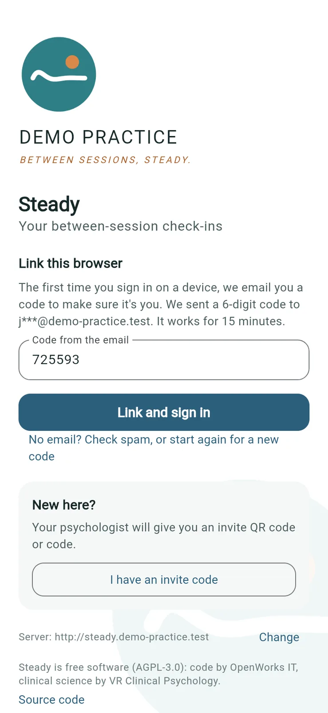

4. On **Choose your own password**, type the **Temporary password** again, then your **New password** twice, and tap **Save password**. It needs at least 10 characters; a short sentence works well.

   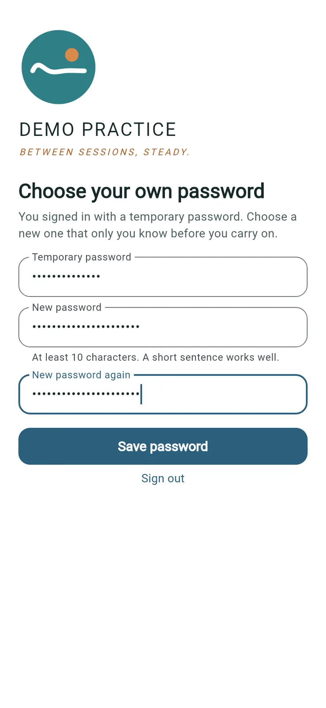

5. On **Set up two-step sign-in**, open your authenticator app, add an account and scan the QR code. If you're setting up on the same phone, use the buttons next to the key to copy it or open it in the authenticator app. Type the 6-digit code the app shows in **Code** and tap **Switch on**.

   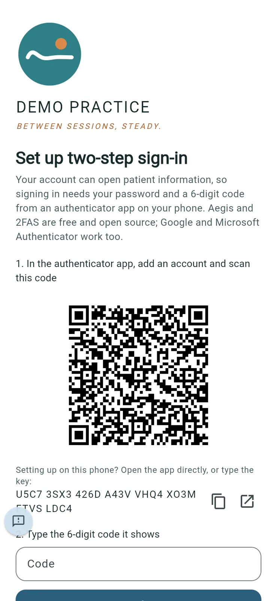

6. Steady shows eight **recovery codes**. Keep them somewhere safe, away from your phone: printed, or in a password manager. Each one signs you in once if you lose your phone. Tap **Copy codes** if you want to paste them into a password manager, then tap **I've kept them safe**.

   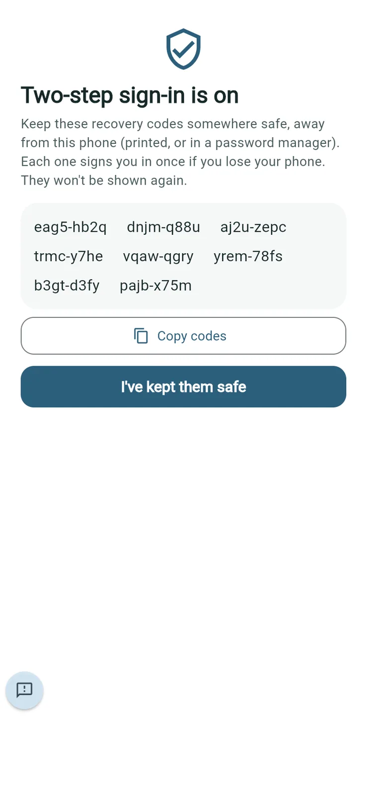

**Good to know**

- Two-step sign-in is required for all practice staff. You can't switch it off.
- The recovery codes aren't shown again.
- Steady emails you when your password is changed or a recovery code is used. These emails are about your own account only; Steady never puts patient information in an email.

## The master psychologist: sign the operator agreement

*Purpose: the practice's written agreement with OpenWorks IT, which POPIA asks for because OpenWorks runs the practice's Steady server.*

The first time the master psychologist signs in, Steady asks them to sign the operator agreement before they can use it.

1. Read the agreement on the **Operator agreement** screen.

   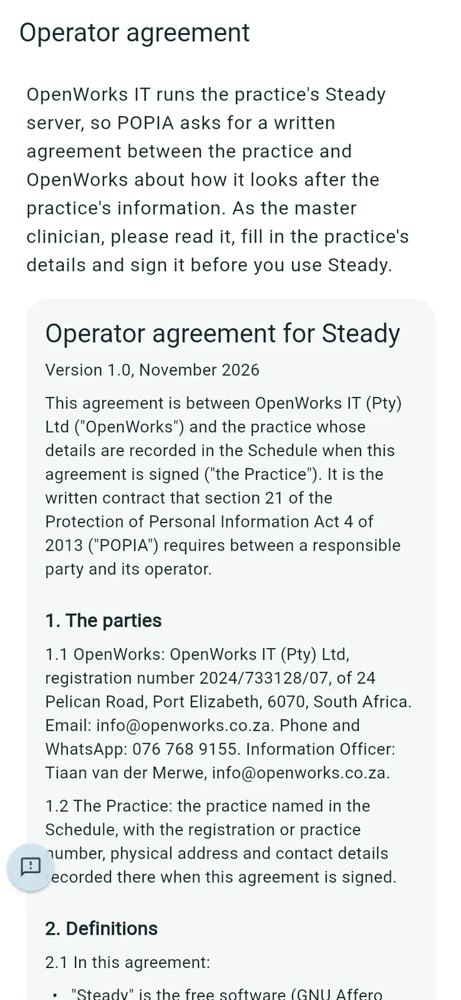

2. Scroll down and fill in **The practice**: **Practice's legal name**, **Registration or practice number**, **Physical address**, **Contact email** and **Contact phone number**.
3. Under **Information Officer**, leave the box ticked if you, the master clinician, are the practice's Information Officer. Untick it to give someone else's name, email and phone number.
4. Under **Sign**, type **Your full name, as your signature**, tick **I'm authorised to sign for the practice and agree to this agreement**, and tap **Sign**.

   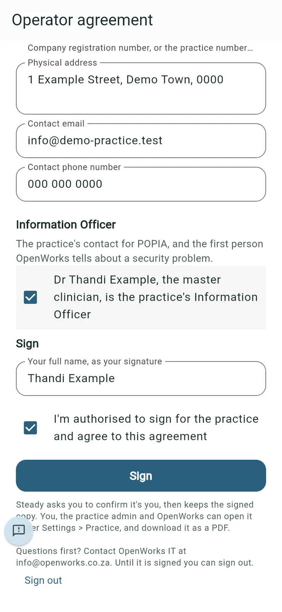

5. Steady asks you to confirm it's you (see below). Steady then says **Signed. The signed copy is under Settings > Practice > Operator agreement.**

**Good to know**

- Until it's signed, you can only read it or sign out. Questions first? Contact OpenWorks IT at info@openworks.co.za.
- If OpenWorks IT publishes a new version, you're asked to sign again the next time you open Steady.
- Signing is logged in the audit report.

## Confirm it's you

*Purpose: a second check before sensitive actions.*

Before a password reset, adding staff, an export, deleting an account, reading the audit report, removing a device, stopping or restoring an account, or signing the operator agreement, Steady may show **Confirm it's you**.

1. In a browser: type the code from your authenticator app in **6-digit code** and tap **Confirm**. On a phone, Steady asks for the phone's screen lock instead.

   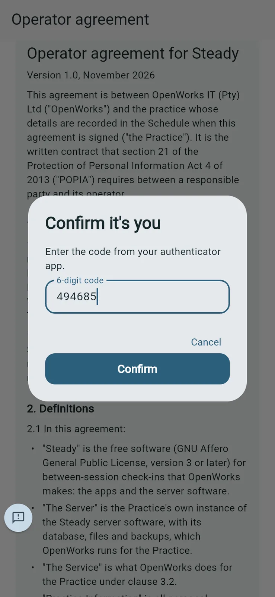

**Good to know**: once you've confirmed, Steady doesn't ask again for about five minutes.

## Your first screen

Psychologists (including the master psychologist) start on **Patients**. Until you invite someone, it says **No patients yet**. The practice administrator starts on **Practice** (see Part 2).

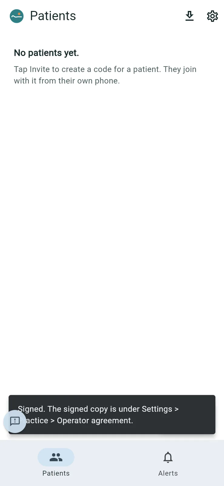

## Signing in on other days

*Purpose: the everyday sign-in.*

1. Type your **Email** and **Password** and tap **Sign in**.
2. Type the **Code from your authenticator app** and tap **Sign in** again. Lost your phone? Type one of your recovery codes instead.

   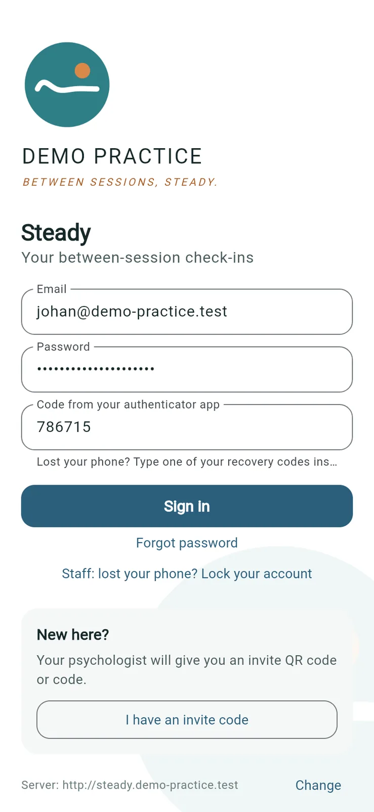

**Good to know**

- On a new phone or browser, Steady also emails you a code to link it (step 3 above).
- In a web browser, your session belongs to that browser tab. It stays signed in while the tab is open; close the tab and you sign in again next time.
- On a phone, Steady always asks for the phone's own screen lock (fingerprint, face, PIN or pattern) when you open it.
- **Sign out** (in Settings) signs you out on all your devices.

## If your phone is lost or stolen

*Purpose: stop anyone else getting in with your phone.*

1. On the sign-in screen of any device, tap **Staff: lost your phone? Lock your account**.
2. Type your **Email** and **Password** and tap **Lock my account**.

   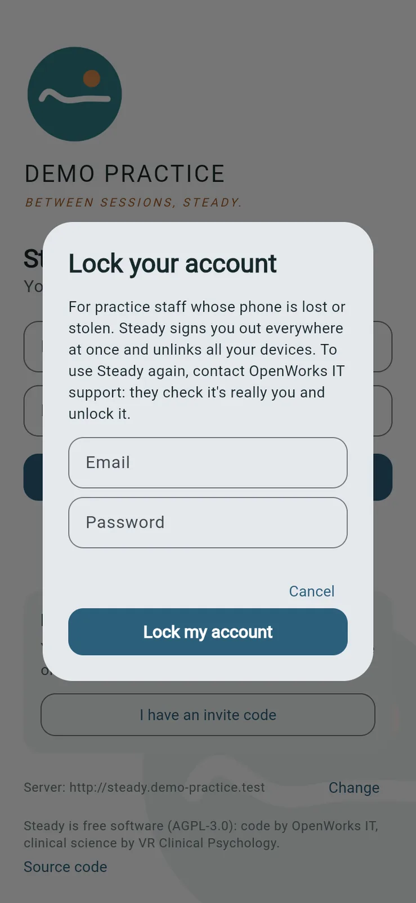

You're signed out everywhere and every device is unlinked. Steady emails you a note of it. To use Steady again, contact OpenWorks IT support: they check it's really you and then restore the account. You can also lock your account from **Settings > Your devices > Lock my account**.

## Forgot your password

Tap **Forgot password** on the sign-in screen. Steady can't reset it by email: ask the master psychologist or practice administrator to reset it. They give you a temporary password and you choose your own when you sign in.

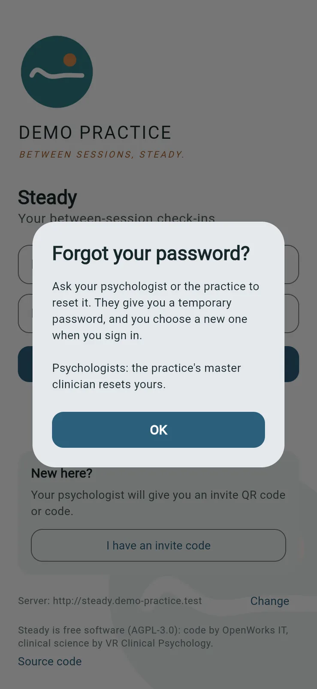

## The Feedback button

The round button at the bottom left of every staff screen sends feedback or a bug report. See [Feedback and feedback tickets](#feedback-and-feedback-tickets).
