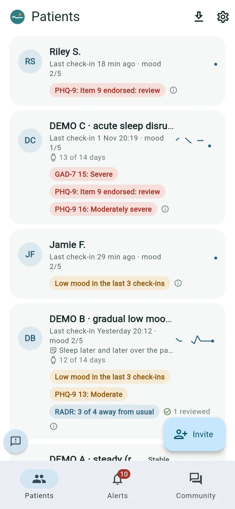
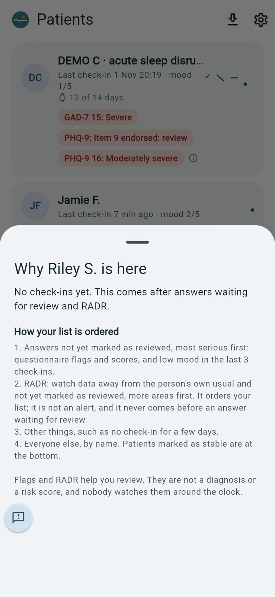
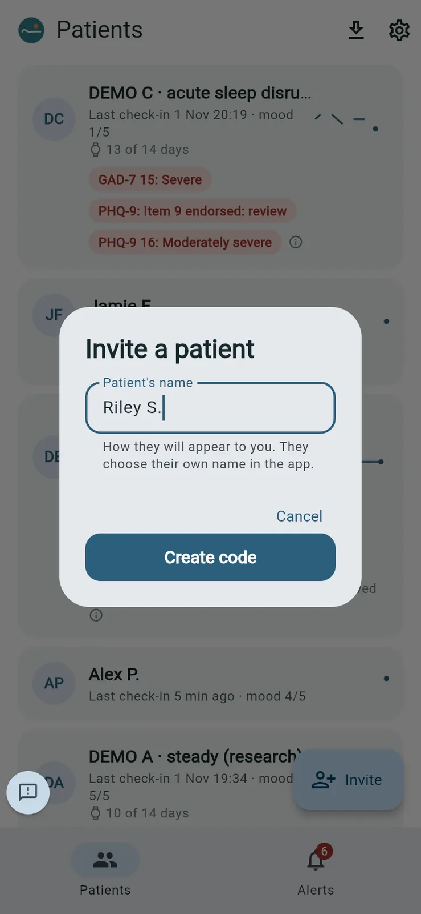
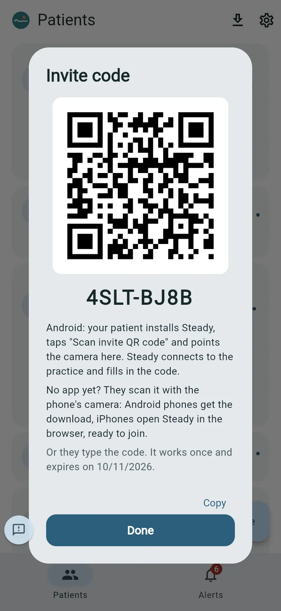
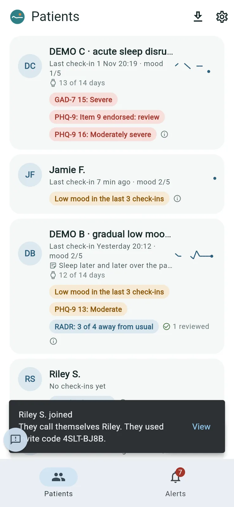

# Your patient list and inviting patients

The bottom bar has **Patients**, **Alerts** and, if your practice has the Steady community, **Community**. The gear at the top right of **Patients** opens **Settings**. The download arrow next to it is **Export**.

## Your patient list

*Purpose: see who needs your attention first.*

**Patients** lists your own patients, with the patients colleagues have shared with you. Each card shows the patient's name (as you named them), their last check-in and mood, how many of the last 14 days have watch data, a small mood trend, your latest note, and any flags.

The list is ordered, not alarmed:

1. Answers not yet marked as reviewed come first, most serious first: questionnaire flags and scores, and low mood in the last three check-ins.
2. Then RADR: watch data away from the person's usual, not yet marked as reviewed.
3. Then the rest, such as no check-in for a few days.
4. Patients marked as stable go to the bottom.

Tap a patient's flags (or the ⓘ next to them) to see **Why [name] is here** and **How your list is ordered**.

**Good to know**: flags and RADR help you review. They are not a diagnosis or a risk score, and nobody watches them around the clock.

## Inviting a patient

*Purpose: give a patient a one-time code to join Steady from their own phone.*

1. On **Patients**, tap **Invite**.
2. Type the **Patient's name** as you want to see it (for example, first name and initial). The patient chooses their own name in the app.
3. Tap **Create code**.

   

4. Show the patient the **Invite code** screen:
   - With Steady installed on Android: they tap **Scan invite QR code** and point the camera at the QR code.
   - Without the app: they scan the QR code with the phone's camera. Android phones get the download; iPhones open Steady in the browser, ready to join.
   - Or they type the code under the QR code.

   

5. Tap **Done**. When they join, Steady tells you ("[name] joined") and they appear on your list.

   

**Good to know**

- Each code works once and expires after seven days.
- The patient agrees to the practice's consent statement when they join.
