# A patient's page: flags, notes, watch data and RADR

## A patient's page

*Purpose: everything Steady holds for one patient, in four tabs.*

Tap a patient on **Patients**. The tabs are **Overview**, **Notes**, **Wearable** and **RADR**. At the top right: the send button (**Send something**) and the menu (⋮).

**Overview** shows, from the top:

- the name the patient uses in the app ("Calls themselves … in the app");
- flags (tap one to mark it as reviewed);
- **Last 14 days**: daily averages of mood and anxiety;
- **Watch · last 7 days**, with the person's usual range shaded (tap a row for the full chart);
- **Send a questionnaire or exercise**;
- **Questionnaires and exercises**: what you've sent, with scores;
- **Check-ins**: each check-in with its four ratings and the patient's own words.

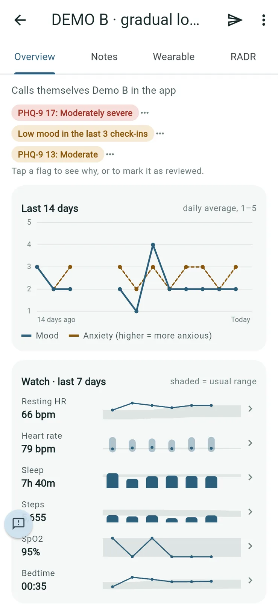

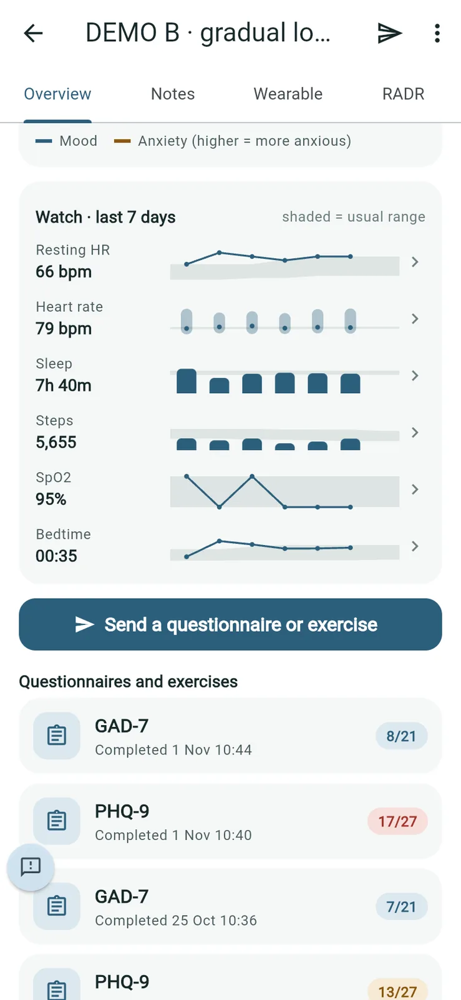

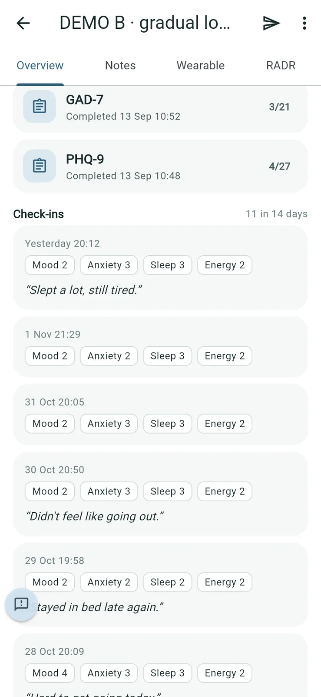

**Good to know**: opening a patient, their watch data, RADR and notes is recorded in the practice's audit report.

## Marking a flag as reviewed

*Purpose: show you've dealt with something, so it stops moving the patient up your list.*

1. On the patient's **Overview**, tap the flag.
2. Optionally type **What you did**.
3. Tap **Mark as reviewed**.

   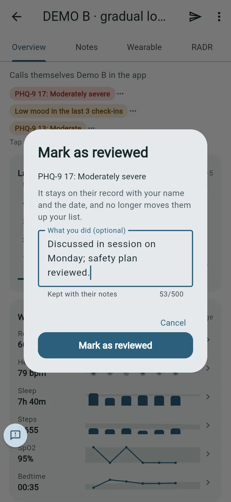

The flag stays on their record with a tick, your name and the date. What you typed is added to the patient's notes.

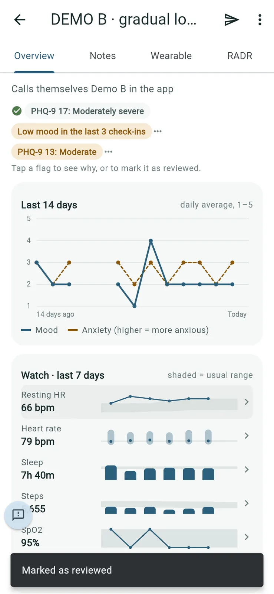

## Notes

*Purpose: short working notes about the patient in Steady.*

1. Open the **Notes** tab.
2. Type in **Add a note** and tap **Save note**.

   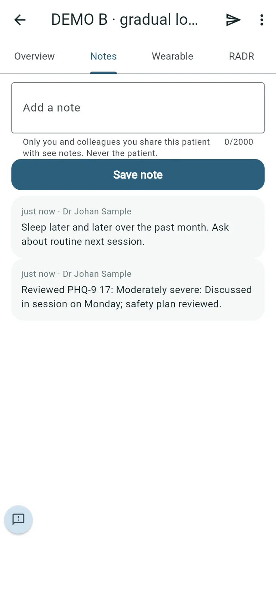

**Good to know**: only you and colleagues you share the patient with see notes. Never the patient. Notes on reviewed flags appear here too.

## Wearable

*Purpose: the patient's watch data over time, if they've chosen to share it.*

1. Open the **Wearable** tab.
2. Choose a period: **Day**, **Week**, **Month**, **6 mo** or **Year**. Use the arrows to go back and forward.
3. Choose a measure: **Resting HR**, **Heart rate**, **Sleep**, **Steps**, **SpO2** or **Bedtime**.

   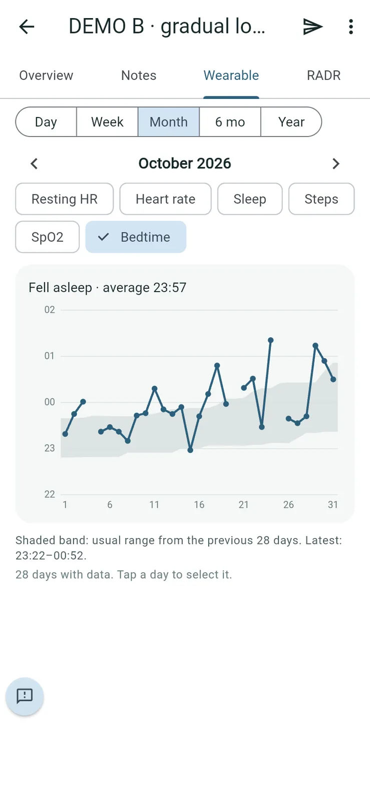

The shaded band is the person's usual range from the previous 28 days. Tap a day to select it. If a patient hasn't connected a watch, the Overview says so; they connect it from their own Steady home screen.

## RADR

*Purpose: how far a patient's watch data and check-ins are from their own normal.*

RADR (Research Amon Dîn Rating) is not a risk score, prediction or diagnosis, and it doesn't raise alerts. It orders your list.

1. Open the **RADR** tab. Choose **4 weeks**, **8 weeks** or **3 months**.
2. **Latest** shows the watch index, how many of four domains (sleep, body clock, activity, heart) are away from usual, the check-in index and the combined figure.

   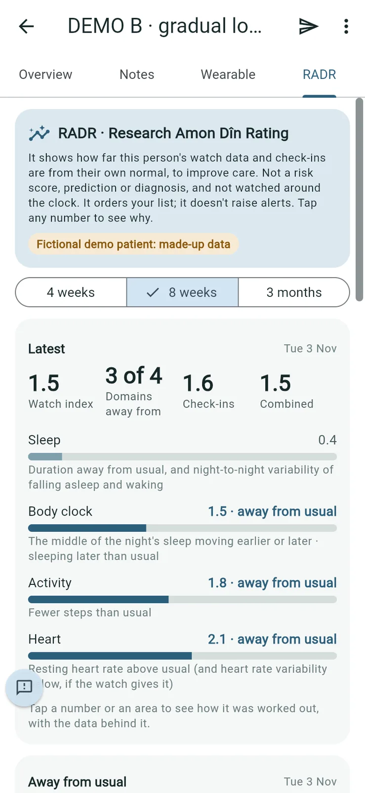

3. Under **Away from usual**, tap a domain to see how it was worked out, with the data behind it.

   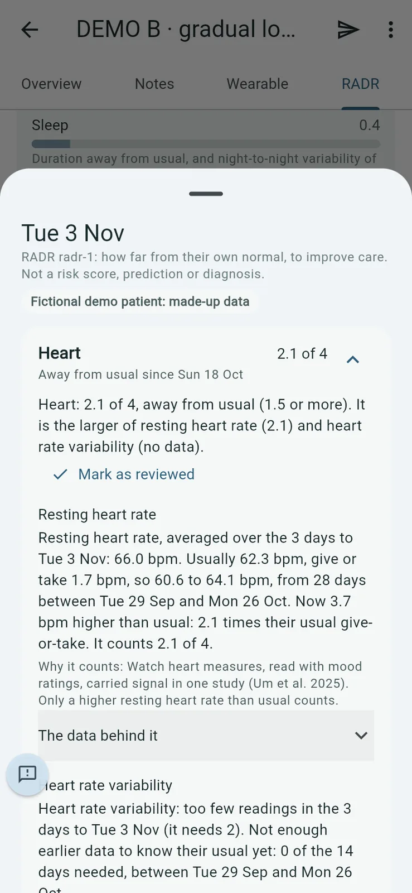

4. To mark it as reviewed, tap **Mark as reviewed**, optionally type **What you did**, and tap **Mark as reviewed** again.

   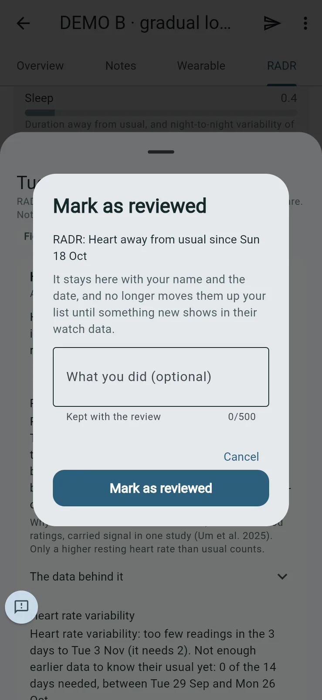

A reviewed domain stops moving the patient up your list until something new shows in their watch data.

## The patient menu

*Purpose: less frequent actions for one patient.*

Tap ⋮ at the top right of the patient's page:

- **Patient settings**: stable, archive, RADR measures.
- **PDF report** and **Export to Excel**.
- **Export for AI note-taking**.
- **Share with a colleague**.
- **Reset password**: the patient gets a temporary password from you.
- **Rename**: how the patient appears to you.
- **Stop access**: they're signed out and can't sign in again; waiting activities are cancelled.

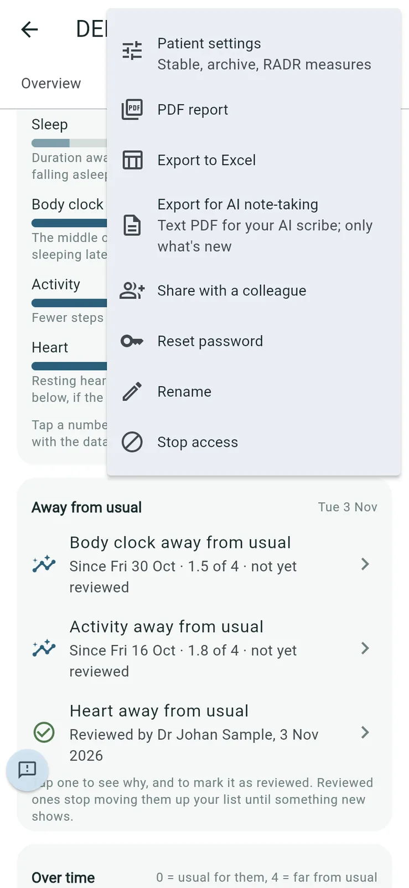

## Stable, ease off, and archiving

*Purpose: keep your list about the people who need attention now.*

1. Open the patient, tap ⋮ and choose **Patient settings**.
2. Under **Where they are in your work**, choose:
   - **Seeing them**: the usual order.
   - **Stable, ease off**: still on your list, at the bottom, with nothing highlighted. Their check-ins and flags are still recorded.
   - **Archive**: you're no longer seeing them. They go off your list; their account and records stay.

   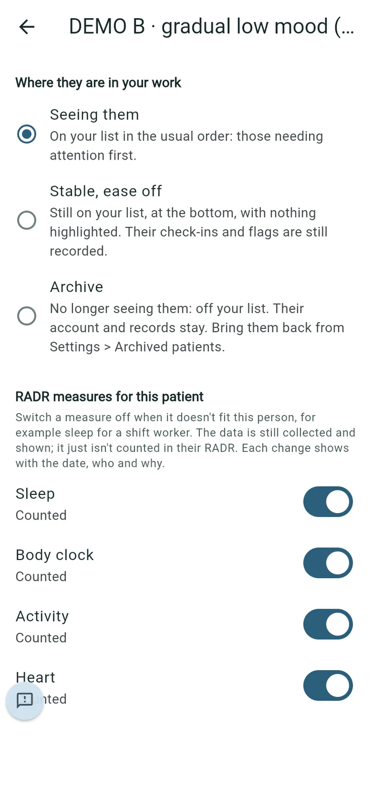

   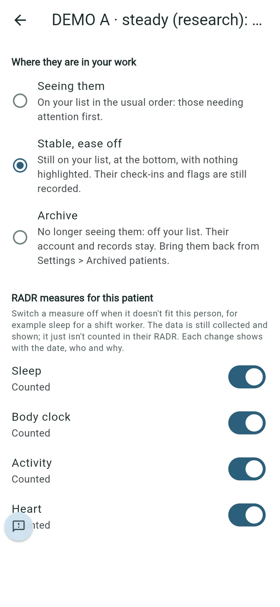

**Good to know**: the change takes effect as soon as you tap it; there's no confirmation step. To bring an archived patient back, go to **Settings > Archived patients** and tap **Reactivate**.

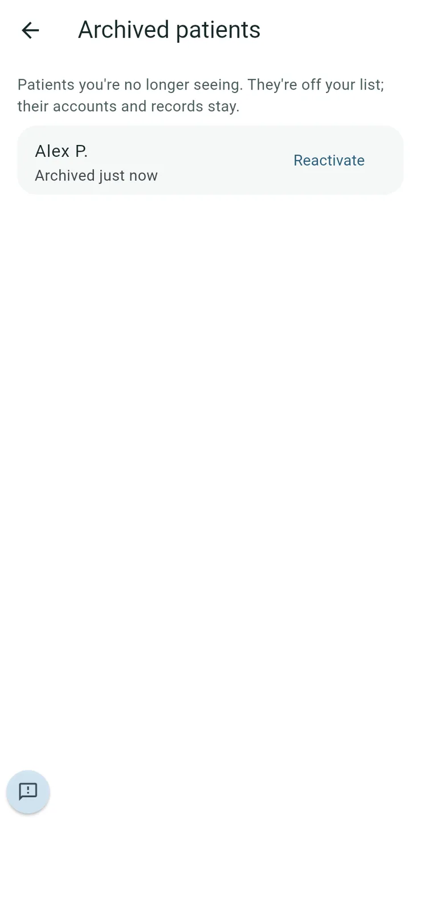

## Switching off a RADR measure for one patient

*Purpose: stop counting a measure that doesn't fit this person, such as sleep for a shift worker.*

1. In **Patient settings**, under **RADR measures for this patient**, switch the measure off.
2. Type **Why** and tap **Stop counting**.

   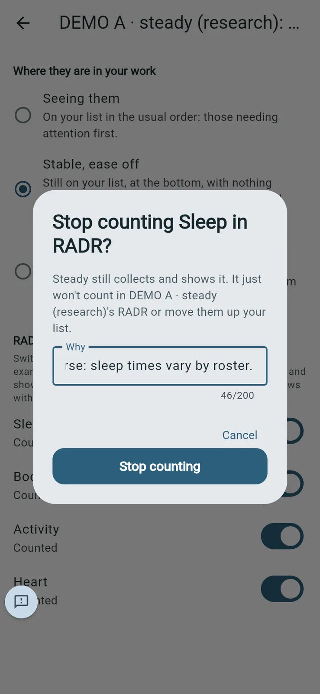

The data is still collected and shown; it just isn't counted in their RADR. Each change shows with the date, who made it and why.
