# Questionnaires, exercises, alerts and the library

## Sending a questionnaire or exercise

*Purpose: ask a patient to complete something between sessions.*

1. On the patient's page, tap **Send a questionnaire or exercise** (or the send button at the top).
2. Choose one item under **Questionnaires** or **Exercises**.

   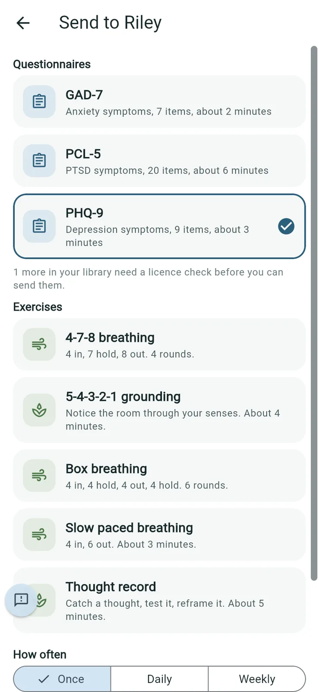

3. Under **How often**, choose **Once**, **Daily** or **Weekly**.
4. Optionally add a **Note for the patient** (for example, "before Thursday's session").
5. Tap **Send [name]**.

   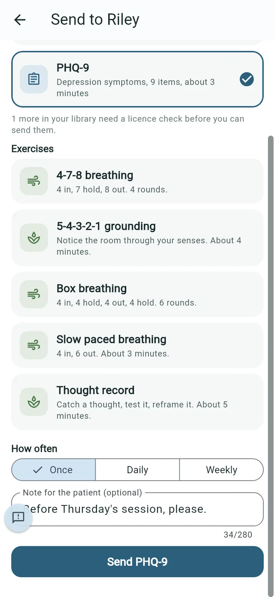

The item shows under **Questionnaires and exercises** as **Waiting** until the patient completes it.

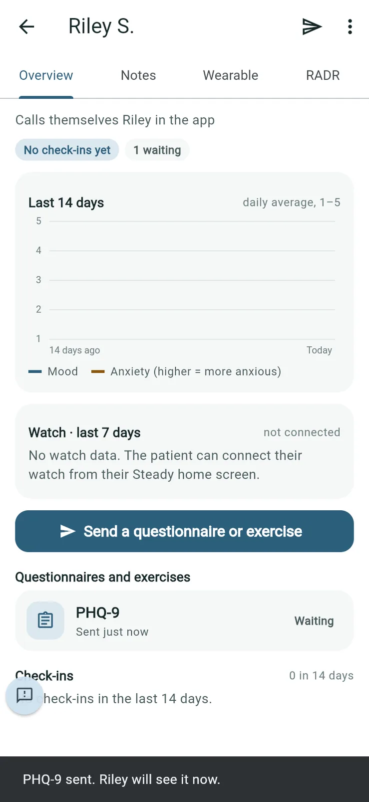

**Good to know**: only instruments the practice has cleared can be sent. Others wait in the library for a licence check (see [The library](#the-library)).

## Alerts and reading a result

*Purpose: see what's new from your patients.*

**Alerts** lists joins, check-ins and completed questionnaires and exercises, newest first. The number on the tab is how many you haven't read. **Review** marks a result with a flag; **Note** marks a check-in that raised one.

1. Tap **Alerts**.
2. Tap an alert to open it. A completed questionnaire opens its **Result**: the total, the band, any flags, and each answer.

   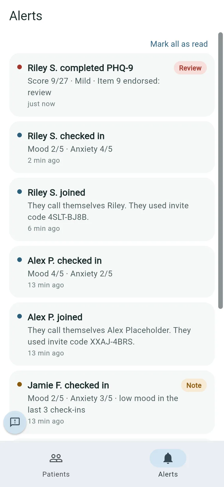

   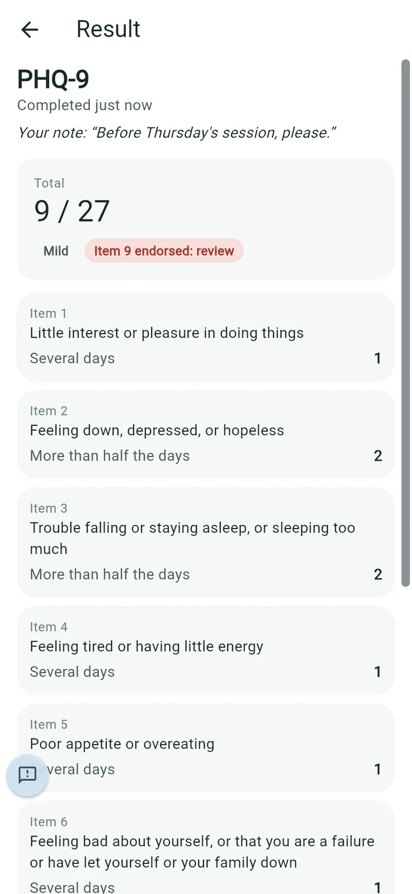

3. Tap **Mark all as read** when you've been through them.

**Good to know**

- Patients never see their scores, bands or flags. Only you do.
- In the phone app, Steady also sends a notification. Every notification says only "New notification", with no patient details; open Steady to see what's new. The web version can't send notifications.

## The library

*Purpose: the questionnaires and exercises you can send, and the words patients see each day.*

Go to **Settings > Practice > Library**.

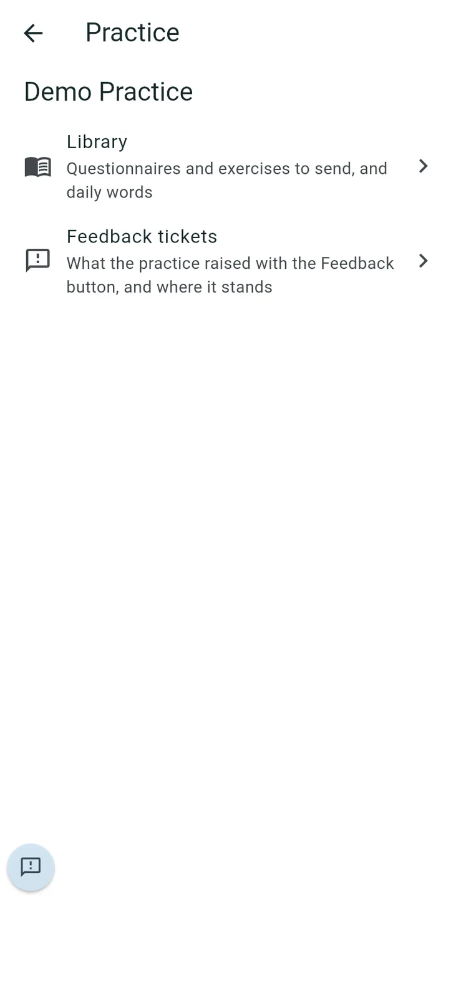

**Ready to send** lists what the practice has cleared. **Needs a licence check** lists instruments the practice hasn't yet confirmed it may use.

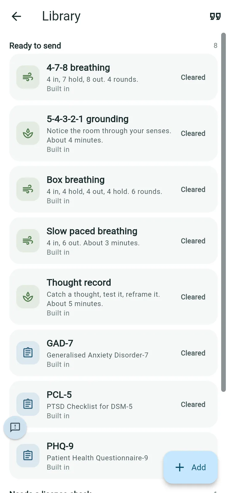

**To clear an instrument for use**

1. Tap it under **Needs a licence check**. Read its **Licence**.
2. Tap **Confirm the practice may use this**.
3. Tick **I confirm the practice has the right to use this instrument with patients.** and tap **Confirm**.

   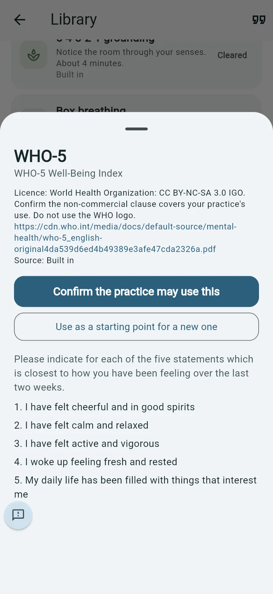

   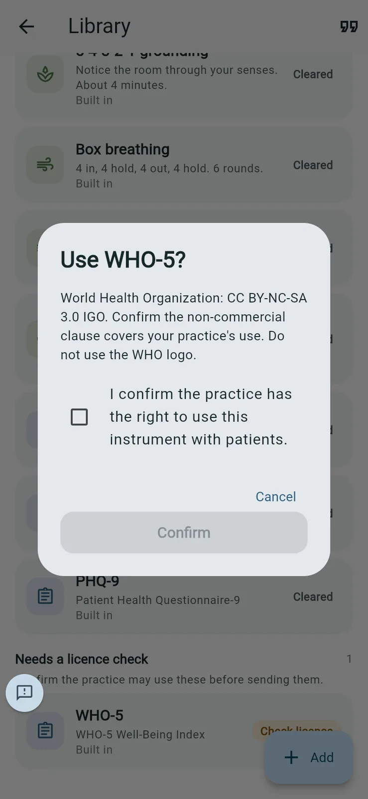

**To build your own questionnaire or exercise**

1. In the library, tap **Add** and choose **Create a questionnaire or exercise**. (Or open an existing one and tap **Use as a starting point for a new one**.)

   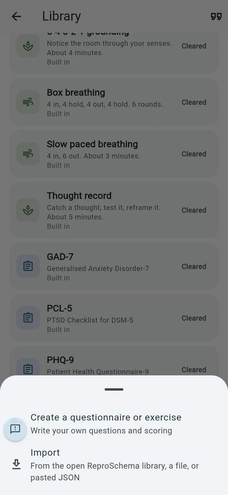

2. Choose **Questionnaire**, **Steps** or **Breathing**.
3. Fill in **Short name**, and optionally **Full name** and **One line patients see**, then **Instructions**.
4. Under **Answer options**, tap a preset (**How often (0–3)**, **Agreement (0–4)**, **How much (0–4)** or **Yes / No**) or type your own labels and scores.

   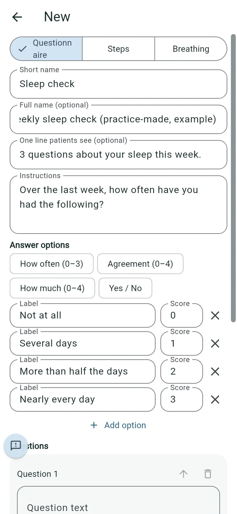

5. Under **Questions**, type each **Question text**. Tap **Add question** for more. Set **Flag for review when the score is at least** if an answer should raise a flag.
6. Under **Scoring**, keep **Add up the option scores** on for a total, and tap **Add band** to name ranges of totals.
7. Tap **Save to library**.

   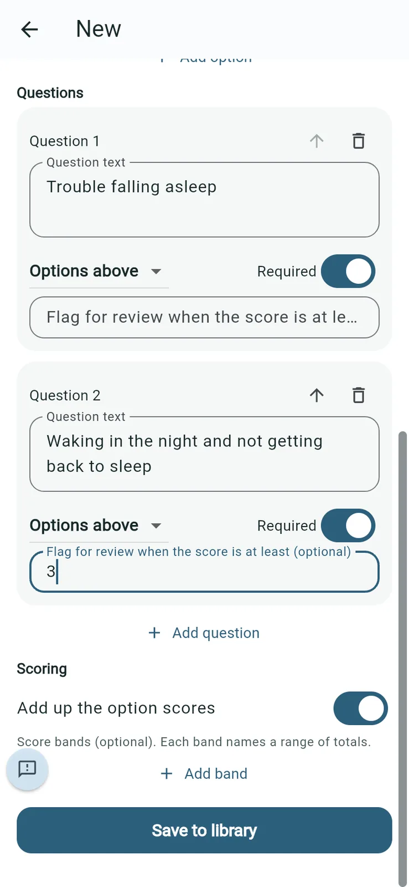

**To import an instrument**: tap **Add**, then **Import**. Choose one from the open ReproSchema library, a file, or pasted JSON. Imports wait under **Needs a licence check** until you confirm them.

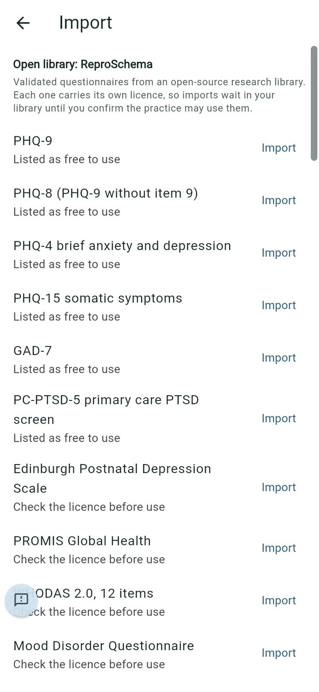

**Daily words**: the quotation-mark button at the top right of the library (**Daily words for your patients**) opens **Daily words**. Each day patients first see a few calm words and a breathing circle. Add your own; they're mixed in with the ones that come with Steady.

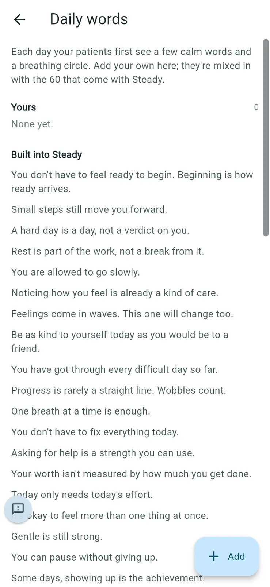

**Good to know**: the library is shared across the practice, so colleagues can send what you add. Only the person who created or imported an item can **Edit** or **Archive** it; it shows as **Own** in their library.
