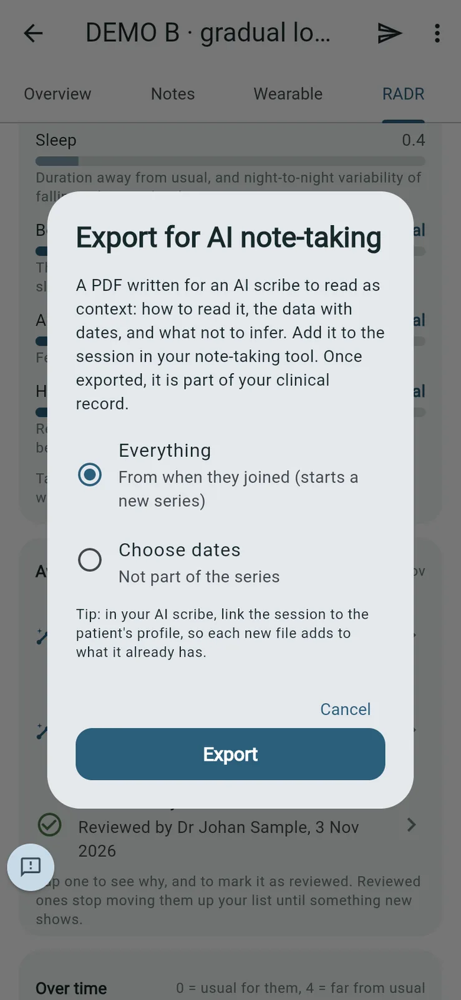
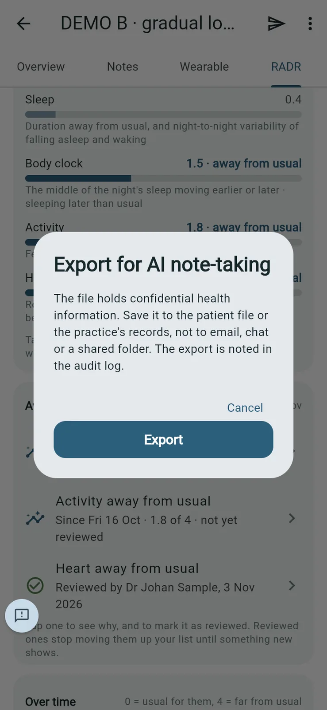
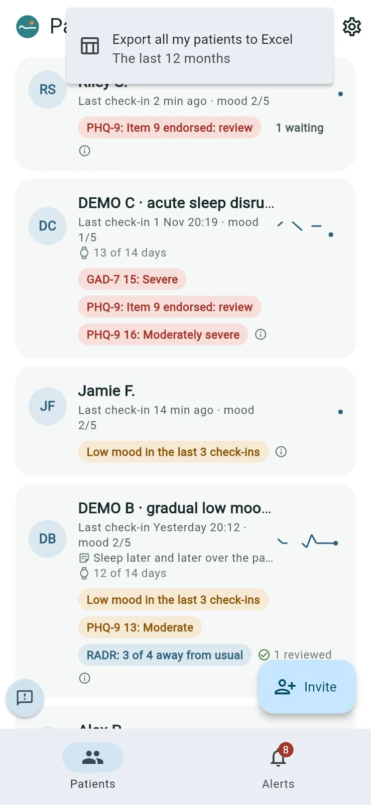
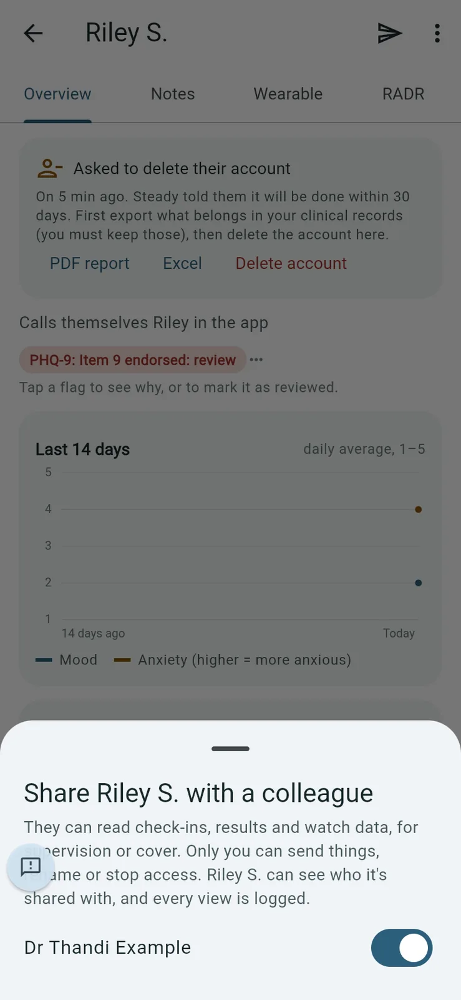
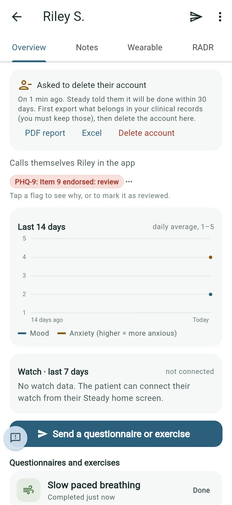
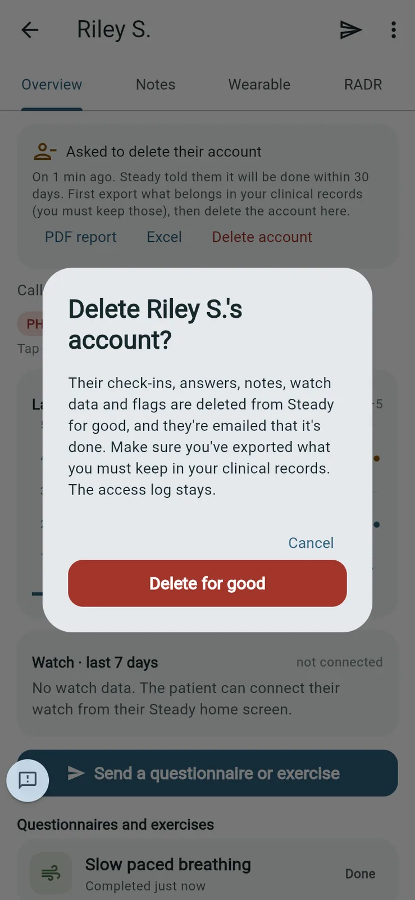

# Exports, sharing and deletion requests

## Export for AI note-taking

*Purpose: a text PDF your AI note-taking tool can read as context for a session.*

1. On the patient's page, tap ⋮ and choose **Export for AI note-taking**.
2. Choose what to include:
   - **Since the last export**: only what's new, as the next part of the series. This is offered once you've exported this patient before.
   - **Everything**: from when they joined. This starts a new series.
   - **Choose dates**: a one-off file, not part of the series.
3. Tap **Export**.

   

4. Read the warning and tap **Export** again, then confirm it's you.

   

5. Add the file to the session in your note-taking tool.

**Good to know**

- With **Since the last export**, each file adds to what your note-taking tool already has. Tip from the app: in your note-taking tool, link the session to the patient's profile.
- The file holds confidential health information. Save it to the patient file or the practice's records, not to email, chat or a shared folder.
- Once exported, it's part of your clinical record.
- Each export is recorded in the audit report.

## Other exports

- **PDF report** and **Export to Excel**, in the patient menu, export one patient.
- **Export** (the download arrow on **Patients**) offers **Export all my patients to Excel**, covering the last 12 months.

All exports ask you to confirm it's you and are recorded in the audit report.

## Sharing a patient with a colleague

*Purpose: let another psychologist read a patient's record, for supervision or cover.*

1. On the patient's page, tap ⋮ and choose **Share with a colleague**.
2. Switch on the colleague's name. Switch it off to stop sharing.

   

**Good to know**: your colleague can read check-ins, results and watch data, but only you can send things, rename the patient or stop access. The patient can see who they're shared with in their Settings, and every view is logged.

## When a patient asks to delete their account

*Purpose: carry out a patient's deletion request.*

Patients ask from the app (see *What your patients see*). The request shows at the top of the patient's page: **Asked to delete their account**. Steady tells the patient it will be done within 30 days.

1. First export what belongs in your clinical records: tap **PDF report** or **Excel**. You must keep those.
2. Tap **Delete account**.
3. Read the warning and tap **Delete for good**, then confirm it's you.

   

   

**Good to know**: their check-ins, answers, notes, watch data and flags are deleted from Steady for good, and the patient is emailed that it's done. The audit log of who opened their record stays.
