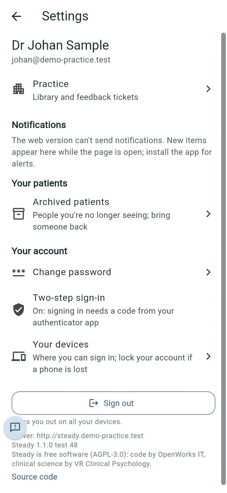
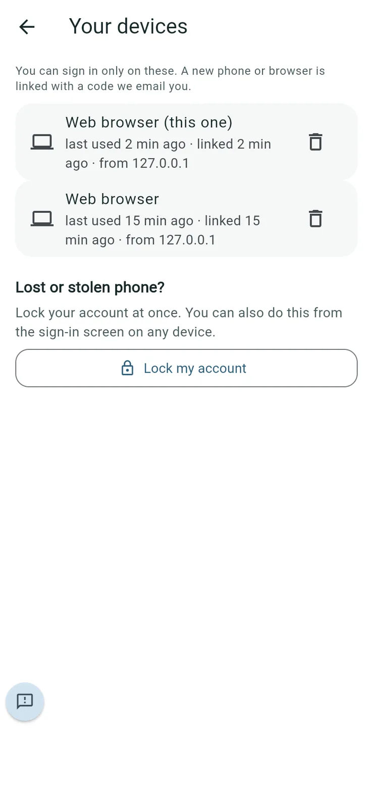
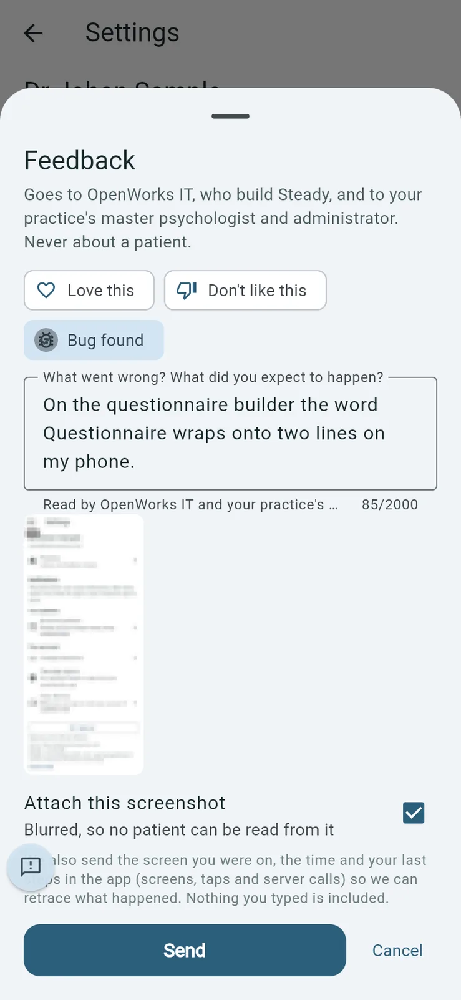
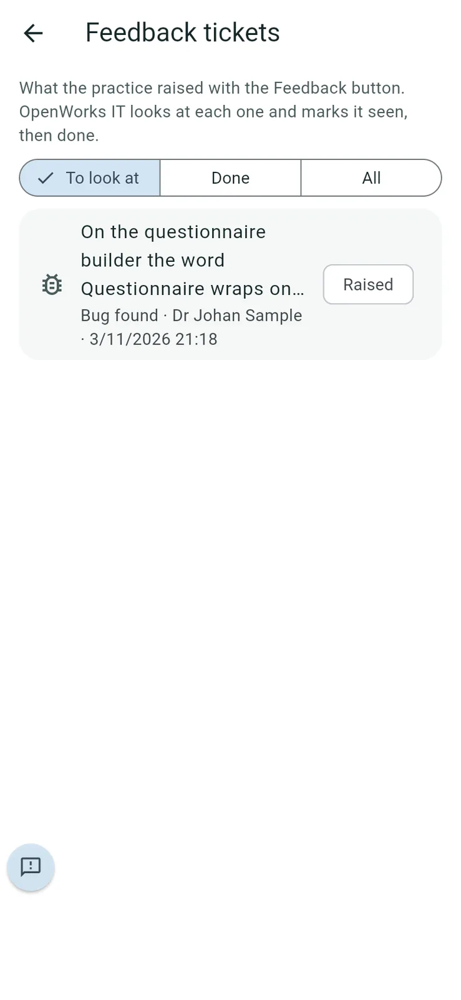
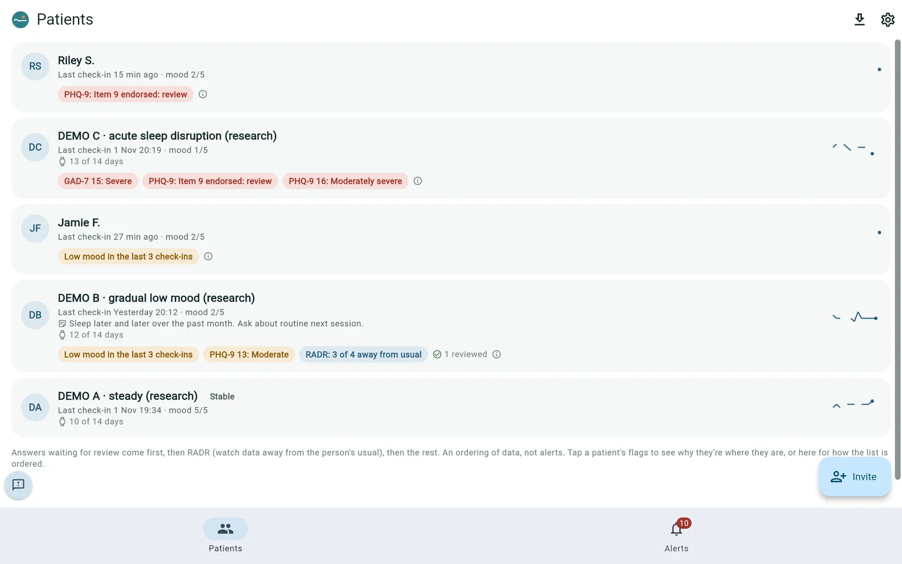
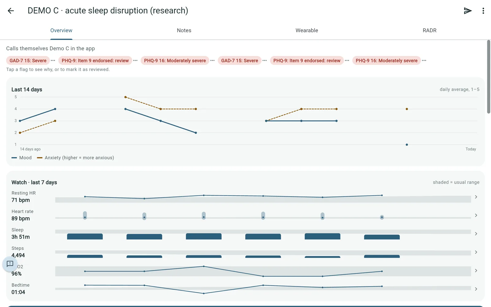
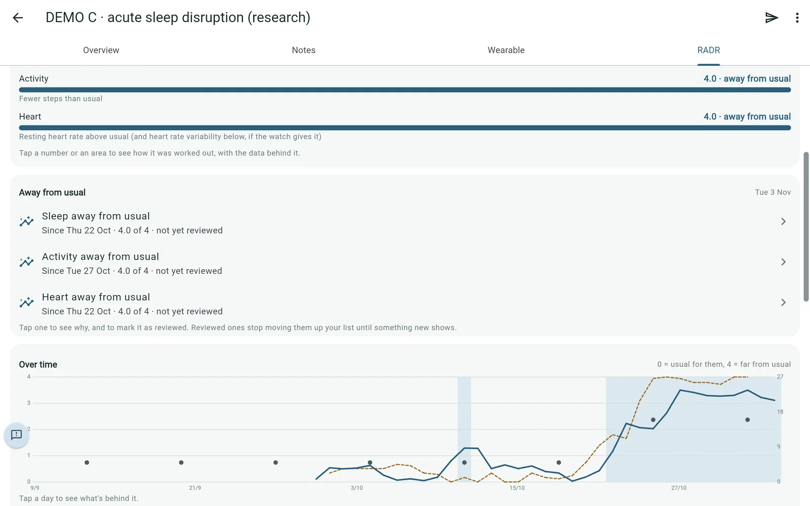

# Settings, feedback, the community and using a computer

## Settings

*Purpose: your account, and the practice's library and tickets.*

Tap the gear on **Patients**.

- **Practice**: the library, feedback tickets and, for the master psychologist, more (see *For practice administrators and the master psychologist*).
- **Notifications**: whether notifications are on.
- **Archived patients**.
- **Change password**, **Change email** (a code goes to the new address, and the old one is told), **Two-step sign-in** and **Your devices**. If you change your email and use the Community, OpenWorks IT approves the new address before you can open it again.
- **Sign out**: signs you out on all your devices.

**Your devices** lists every phone and browser you can sign in on. Tap the bin next to one to remove it; it's signed out at once and needs a new emailed code to sign in again. **Lock my account** is for a lost or stolen phone.

## Feedback and feedback tickets

*Purpose: tell OpenWorks IT what works, what doesn't, and what's broken.*

1. Tap the round **Feedback** button at the bottom left of any screen.
2. Choose **Love this**, **Don't like this** or **Bug found**, and write what happened.
3. Leave **Attach this screenshot** ticked if it helps. It's blurred, so no patient can be read from it.
4. Tap **Send**.

   

To see what the practice has raised and where it stands, go to **Settings > Practice > Feedback tickets**. Choose **To look at**, **Done** or **All**. OpenWorks IT marks each one seen, then done.

**Good to know**: feedback goes to OpenWorks IT and to your practice's master psychologist and administrator. Please don't name patients. Steady also sends the screen you were on, the time and your last steps in the app, so OpenWorks can retrace what happened; nothing you typed elsewhere is included.

## Community

If your practice takes part in the Steady community, psychologists have a **Community** tab in the bottom bar (see the patient list screenshot above). It opens the community forum inside Steady, already signed in as you. Practice administrators have the **Community** tab too, and see only the Steady manual there.

**Who's in:** the master psychologist chooses, in **Settings > Practice > Community**: a switch for each psychologist and administrator. Someone switched on can open the tab once OpenWorks IT has approved them (usually the same day); someone switched off is out straight away. Until you're in, the tab says to ask your master psychologist.

**Good to know**

- It needs two-step sign-in. Patients don't have it.
- It opens only inside Steady, never on its own web address. In a web browser, it works only on your practice's own Steady address.
- Opening the community is recorded in the audit report.

*(Screenshot of the forum itself to follow: the community isn't available on the test copy used for this manual.)*

## Using Steady on a computer

Steady works in a web browser at your practice's Steady address. The screens are the same as on a phone, with more room.

**Good to know**: the web version can't send notifications; new items appear while the page is open. Install the app on your phone for notifications.
