# For practice administrators and the master psychologist

## Who can do what

| | Psychologist | Master psychologist | Practice administrator |
|---|---|---|---|
| Own patients, sending, notes, RADR, exports | Yes | Yes | No |
| Library | Yes | Yes | No |
| People: patients' set-up status, invites, patient password resets, moving and stopping patients | No | Yes | Yes |
| Add psychologists and administrators | No | Yes | No |
| Reset a psychologist's password, stop a staff member's access | No | Yes | Yes |
| Reset the practice administrator's password | No | Yes | No |
| Audit report | No | Yes | Yes |
| Feedback tickets | Yes | Yes | Yes |
| Operator agreement | No | Signs it | Reads it |
| Server health | No | Yes, under Server and updates | Yes |
| Install server updates | No | Yes | No |

The practice administrator sees patients' names and whether their app is set up and connected. They never see what patients share.

## Settings and Practice

The master psychologist opens **Settings** from the gear on **Patients**. **Practice** holds **Library**, **People**, **Audit report**, **Feedback tickets** and **Operator agreement**. Lower down, **Steady version** has **Check for updates**, **Update now** and **Details and history**.

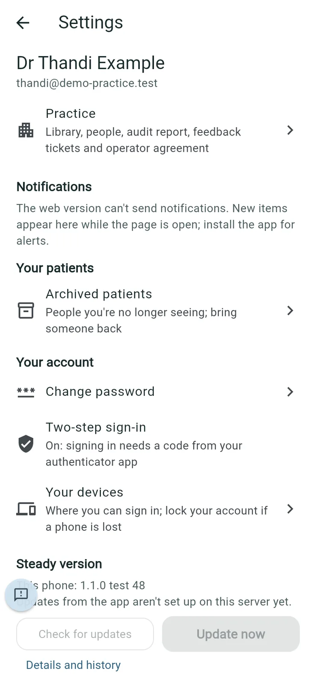

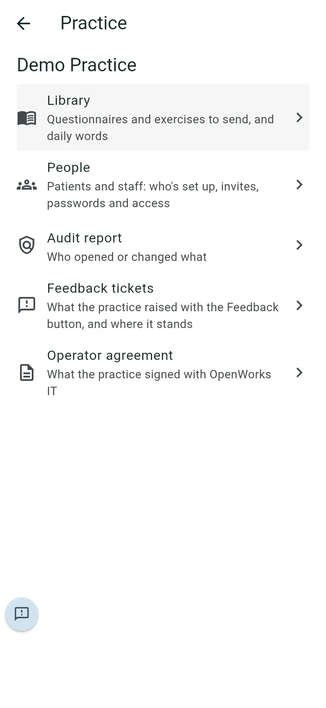

The practice administrator starts on **Practice**, which is the **People** screen (see below). Their **Settings** has **Practice** (**Audit report**, **Feedback tickets** and **Operator agreement**) and **Server health**.

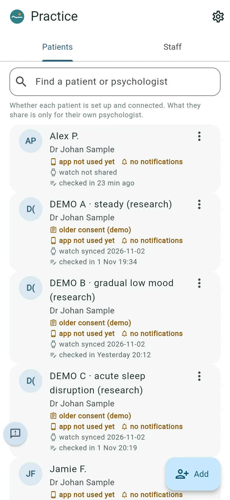

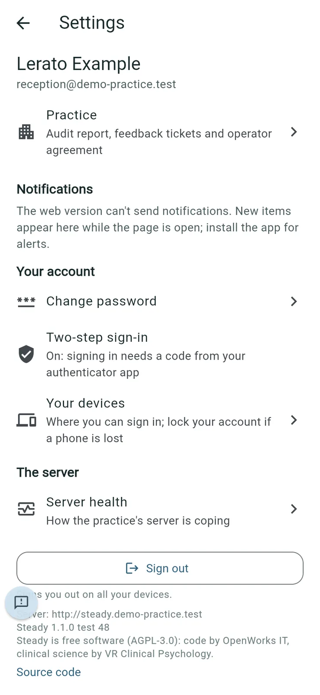

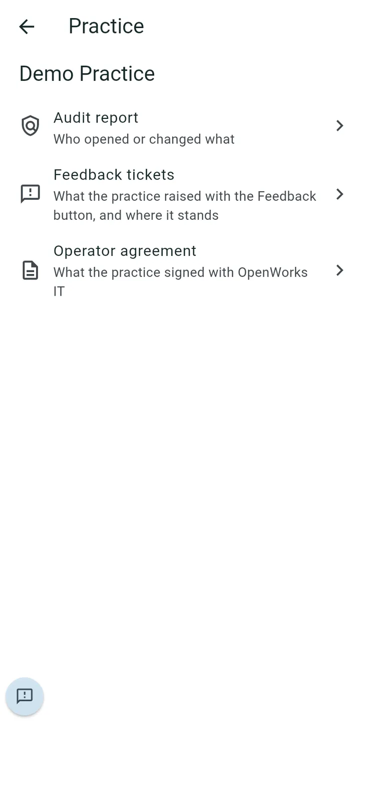

## People: patients

*Purpose: check that each patient is set up and connected.*

1. Go to **Settings > Practice > People** (the administrator's first screen). The **Patients** tab is open.
2. Use **Find a patient or psychologist** to search.

   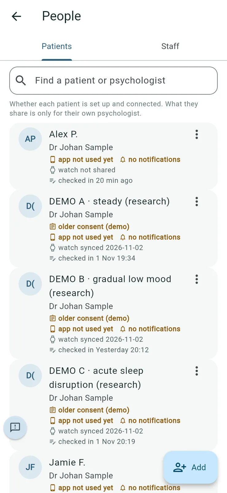

Each patient shows their psychologist and their status, for example **app not used yet**, **no notifications**, **watch not shared**, **watch synced [date]**, **checked in [when]**, **uses the web app**, or **older consent**. Anything shown in amber needs a look.

3. Tap ⋮ next to a patient for **Reset password**, **Move to another psychologist** or **Stop access** (or **Restore access**). If a patient's watch permissions have lapsed, there's also **Remind them to reconnect their watch** (a notice in their app; no health details).

   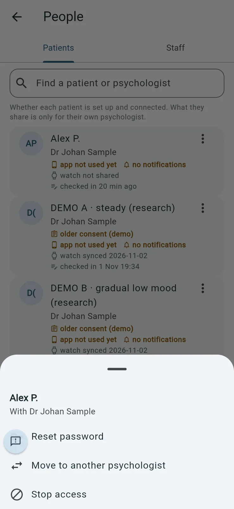

## People: staff

*Purpose: the practice's psychologists and administrators.*

Open the **Staff** tab. Each person shows their email, their role, whether two-step sign-in is set up, and which app they use.

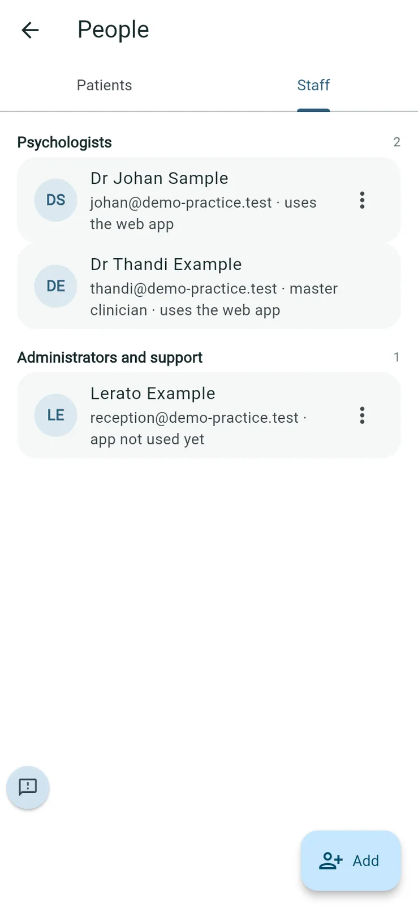

## Adding a psychologist or administrator

1. On **People**, open **Staff** and tap **Add**.
2. Choose **Add a psychologist** or **Add an administrator**.

   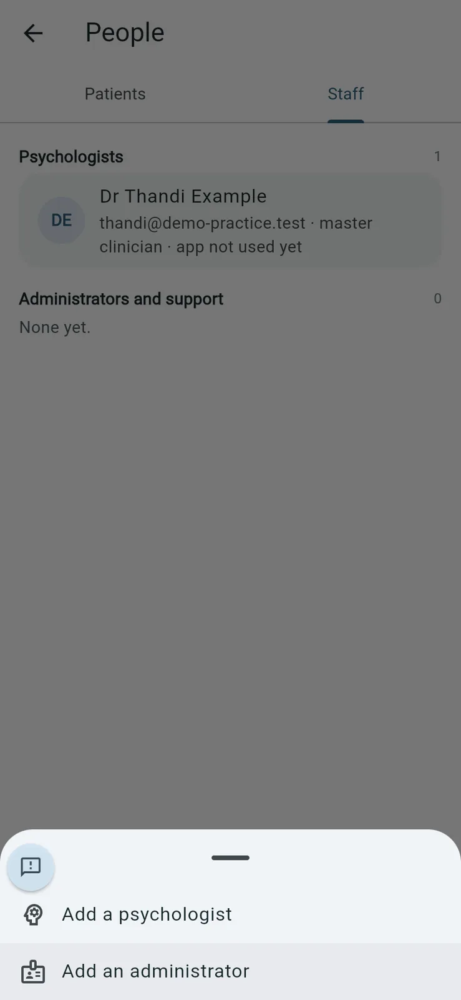

3. Type their **Name** and **Email** and tap **Add**. Confirm it's you if asked.

   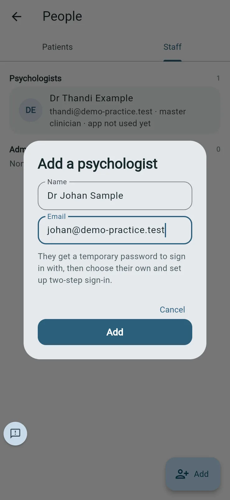

4. Steady shows a **Temporary password**. Give it to them by phone or in person, not by email or chat. It isn't shown again.

   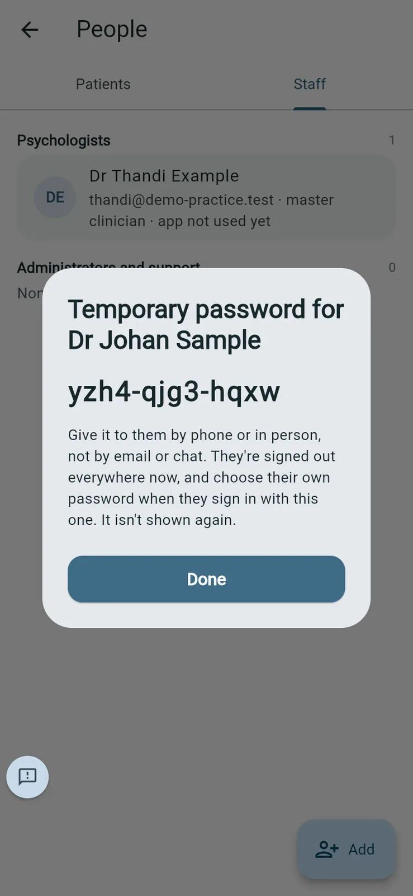

They sign in with it, choose their own password and set up two-step sign-in (see [Your first sign-in](#your-first-sign-in)).

**Good to know**

- Only the master psychologist adds staff. The practice administrator sees "New staff accounts are added by the master clinician."
- OpenWorks IT support accounts are made by OpenWorks on the server, never in the app.

## Resetting a staff member's password

*Purpose: someone has forgotten their password.*

1. On **People > Staff**, tap ⋮ next to the person and choose **Reset password**.

   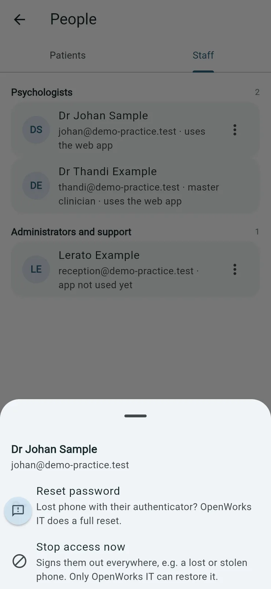

2. Tap **Reset** and confirm it's you.

   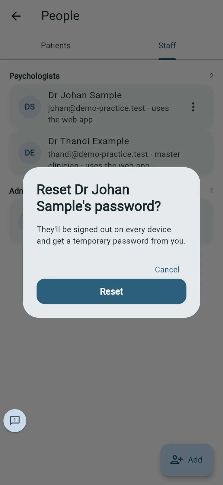

3. Give them the **Temporary password** by phone or in person.

   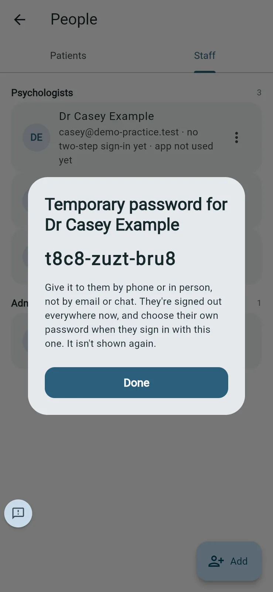

**Good to know**

- They're signed out on every device. They choose a new password when they next sign in.
- A reset here keeps their authenticator. If they've lost the phone with their authenticator and their recovery codes, contact OpenWorks IT for a full reset of two-step sign-in.
- The master psychologist and the practice administrator can reset a psychologist's password; only the master psychologist can reset the administrator's. The master psychologist's own password is reset by OpenWorks IT.
- Resetting a patient's password works the same way, from the patient's ⋮ in **People** or from their page. When anyone other than the patient's own psychologist resets it, Steady also emails the patient a 6-digit code, which they need to finish the reset. That way whoever reset it can't choose the new password themselves.
- **Reset password** still shows for a stopped staff account, but it doesn't restore access.

## Stopping a staff member's access

*Purpose: someone leaves, or their phone is lost or stolen.*

1. On **People > Staff**, tap ⋮ next to the person and choose **Stop access now**.
2. Tap **Stop access** and confirm it's you.

   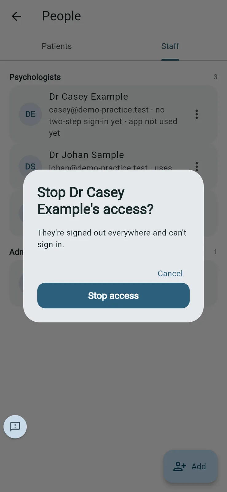

They're signed out everywhere and can't sign in. Their entry shows **stopped**.

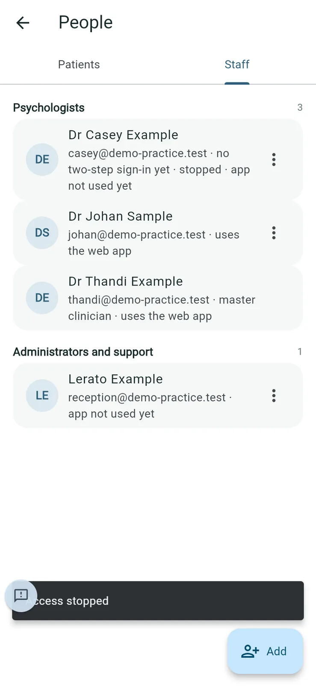

**Good to know**: the master psychologist and the practice administrator can stop a staff member's access, but only OpenWorks IT can restore it, after checking it's really them. A patient's access, by contrast, can be restored from their ⋮ in **People** (**Restore access**).

## Inviting a patient for a psychologist (administrator)

1. On **Practice** (**People**), open **Patients** and tap **Add**.
2. Choose the psychologist under **Invite a patient for**.
3. Type the **Patient's name** and tap **Create code**, then show the patient the **Invite code for [psychologist]** screen, as in [Inviting a patient](#inviting-a-patient).

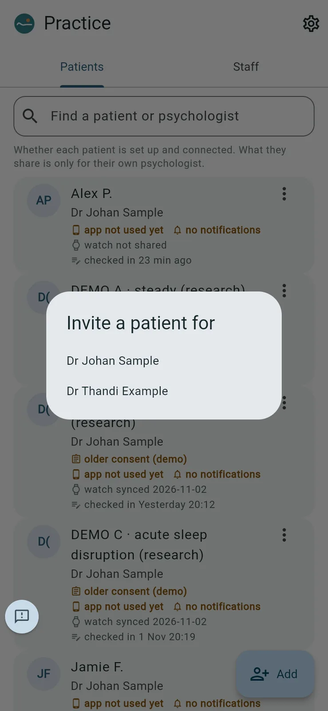

## The audit report

*Purpose: who opened or changed what, for a patient's request to see who accessed their information (POPIA), or a review.*

1. Go to **Settings > Practice > Audit report** and confirm it's you.
2. Choose **Day**, **Week**, **Month** or **Year**.
3. Type a person, patient or action in **Find a person, patient or action** to narrow it down.

   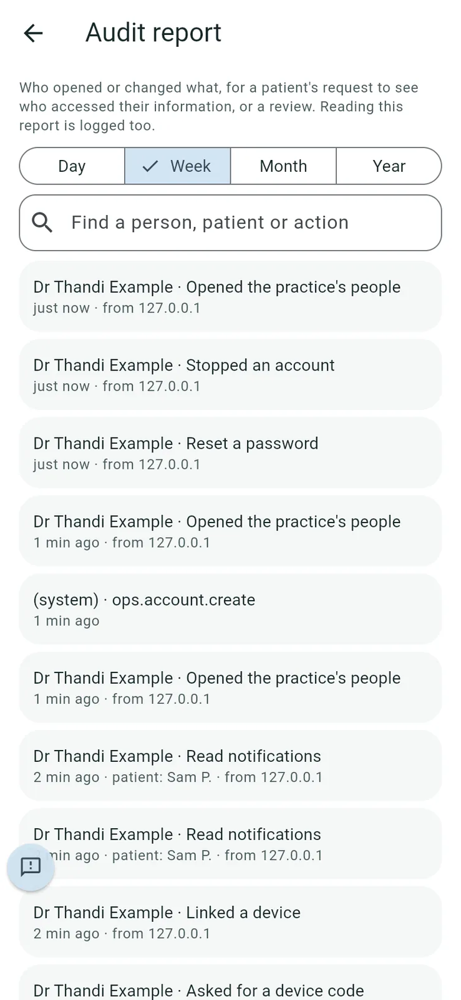

   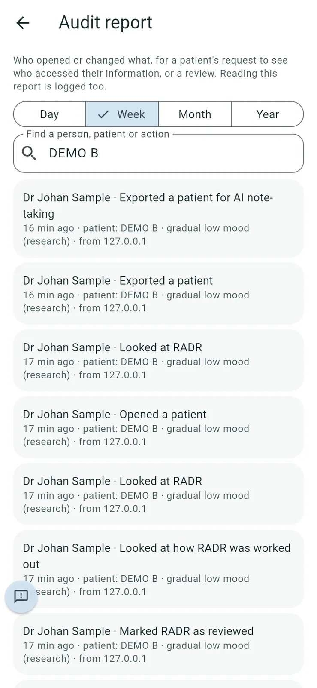

Each row shows who, what, when, which patient and the internet address it came from.

**What's recorded** includes: opening the patient list, a patient, their watch data, RADR and notes; adding notes; marking flags and RADR as reviewed; exports (including **Exported a patient for AI note-taking**); sharing and moving patients; invites and joins; password resets; adding, stopping and restoring accounts; devices linked and removed; signing the operator agreement; signing in to the community; and reading the audit report itself.

## The operator agreement

*Purpose: keep a copy of what the practice signed with OpenWorks IT.*

1. Go to **Settings > Practice > Operator agreement**.
2. Tap **Download PDF** for a copy.
3. The master psychologist can tap **Sign again with new details**, for example when the Information Officer changes. The newest signature counts.

   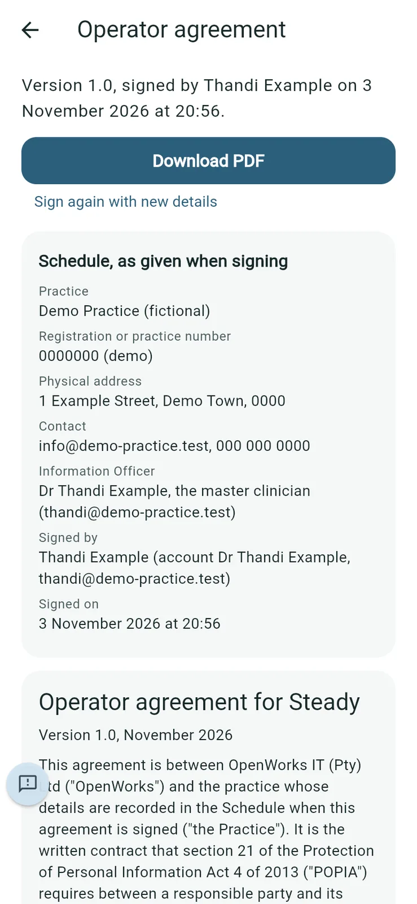

**Good to know**: the master psychologist, the practice administrator and OpenWorks IT can all open the signed copy.

## Server and updates, and server health

*Purpose: see how the practice's Steady server is coping, and install updates.*

The master psychologist: in **Settings**, under **Steady version**, tap **Details and history** to open **Server and updates**. The practice administrator: **Settings > Server health**.

**Server health** shows whether the server is **Running well**, requests in the last hour, how quickly they were answered, errors, a chart of the slowest requests over the last 24 hours, the database size and the number of active patients. Tap the refresh button to update it.

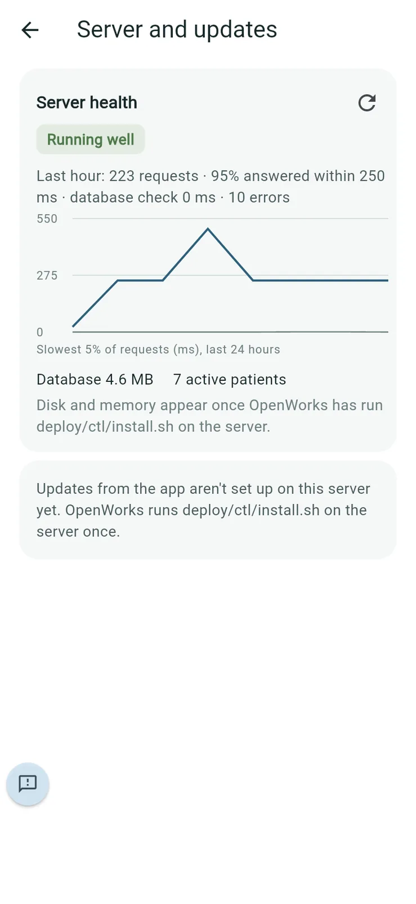

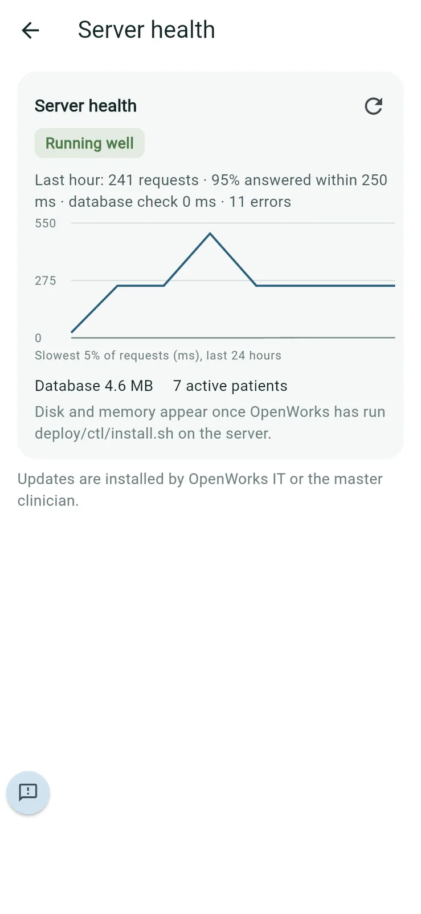

**To install an update** (master psychologist): in **Settings**, under **Steady version**, tap **Check for updates**, then **Update now**.

*(The test copy used for this manual doesn't have updates from the app switched on, so these screenshots show "Updates from the app aren't set up on this server yet". On your practice's server, OpenWorks IT switches this on when it sets the server up. Screenshot of the update panel to follow.)*

**Good to know**: updates are installed by OpenWorks IT or the master psychologist. The practice administrator sees server health but doesn't start updates.
