# What your patients see

Patients see a slow, calm version of Steady: no dashboards, no scores. Crisis numbers are at the bottom of their screens: "This app isn't monitored around the clock. If you need help now, call one of these numbers." (SADAG Suicide Crisis Line 0800 567 567, and 112 from a mobile.)

## Joining

1. The patient scans your invite QR code. On an Android phone without Steady, the code opens a page with **Download Steady for Android** and the steps to install it; there's also a link to use Steady in the browser instead. On an iPhone, it opens the iPhone app's download link if the practice's server has one, or else Steady in the browser.

   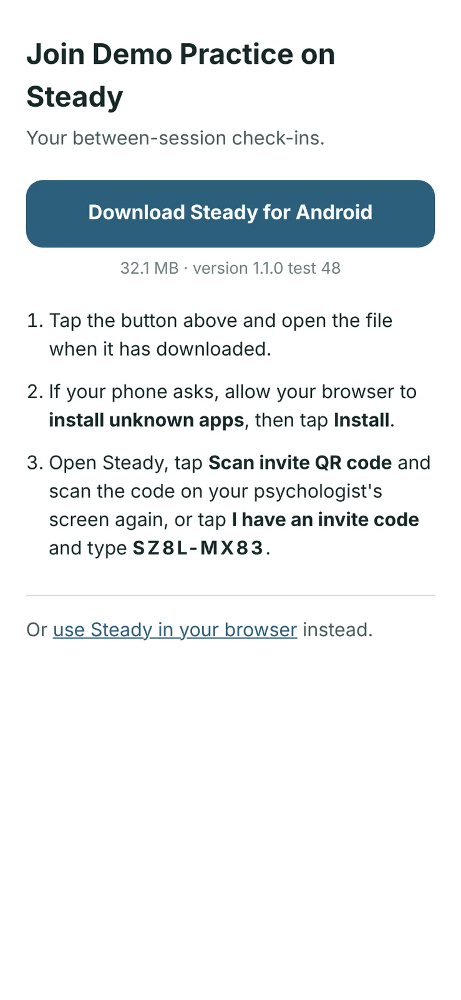

2. They read **Your privacy** (the same notice staff see) and tap **I understand**.
3. On **Join with an invite code**, the code is already filled in (or they type it). They fill in **Your name** (what Steady will call them), **Email** and **Choose a password** (at least 10 characters).
4. They tap **Read the consent statement**, tick **I have read and agree to how [practice] will use my information**, and tap **Create my account**.

   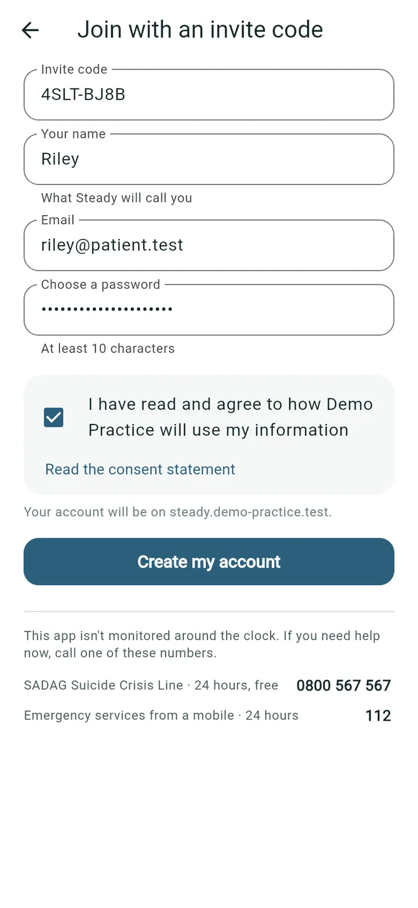

   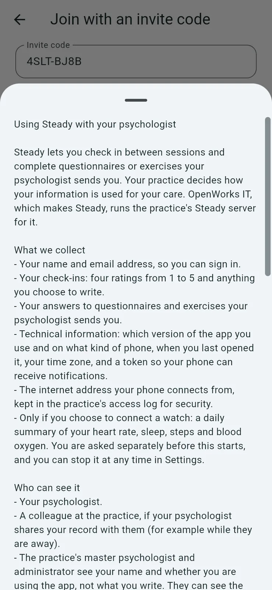

## Each time they open Steady

1. A quiet screen with a few words and a breathing circle. They breathe with it for a moment and tap it when they're ready, or tap **Skip**.

   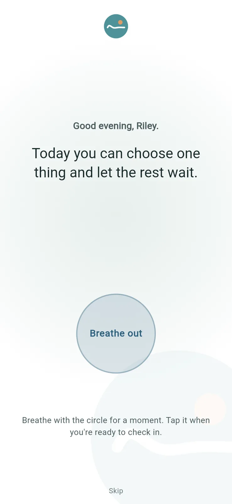

2. If they haven't checked in today: **How are you today?** Four ratings from 1 to 5 (mood, anxiety, sleep, energy), a few words if they like, and **Send**. They can **Skip the check-in**.

   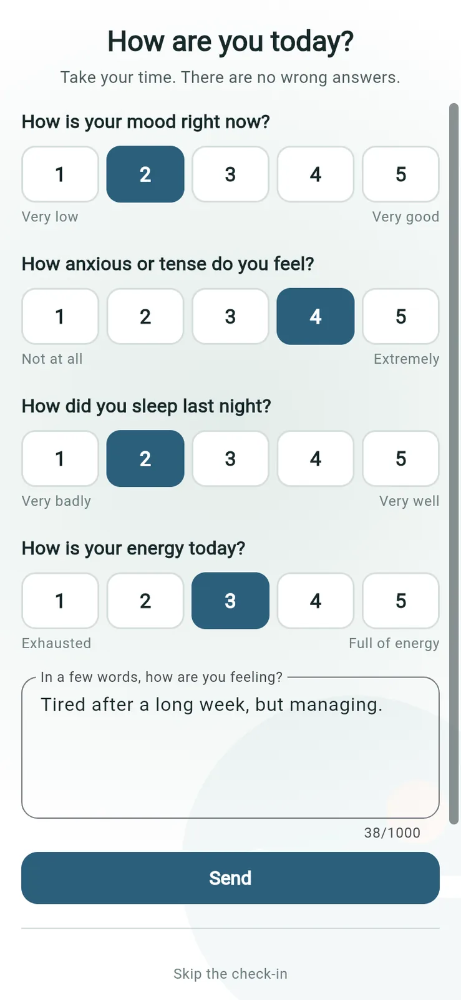

3. Anything you've sent, one at a time: "Your psychologist sent you a questionnaire" (or an exercise), with your note. They tap **Begin**, or **Later**.

   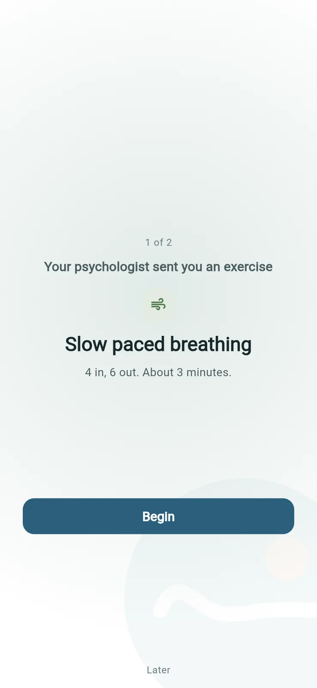

4. A short thank-you, then the home screen.

## The home screen

The patient's home shows whether they've checked in today (**Check in again** is always there), **From your psychologist** (what's waiting), **Your week** (mood over the last seven days, and **See your check-ins**), and **Whenever you need it**: exercises they can do any time. On a phone, they can also connect a watch here (optional).

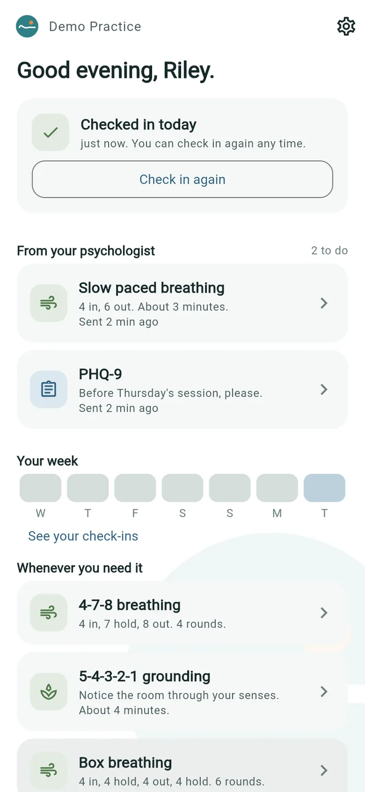

## A questionnaire

They answer each question and tap **Send answers**. They see "Your answers have been sent to your psychologist." They never see a score, a band or a flag.

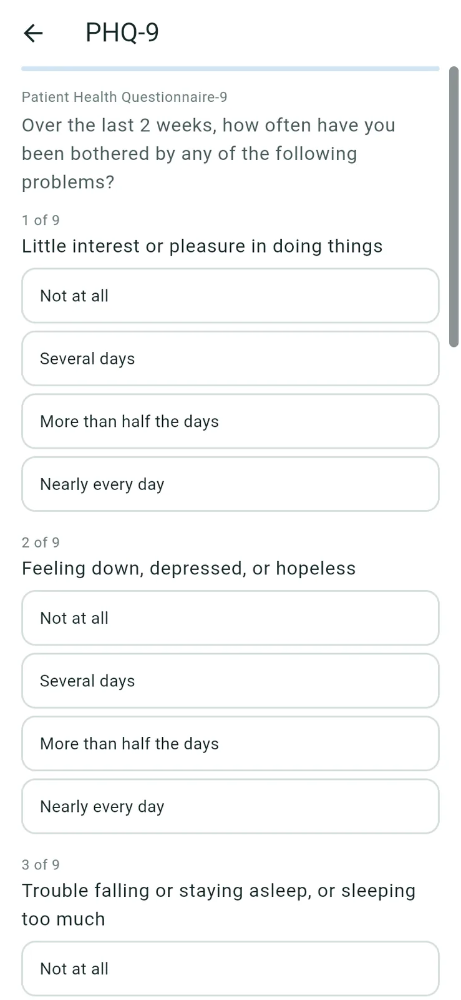

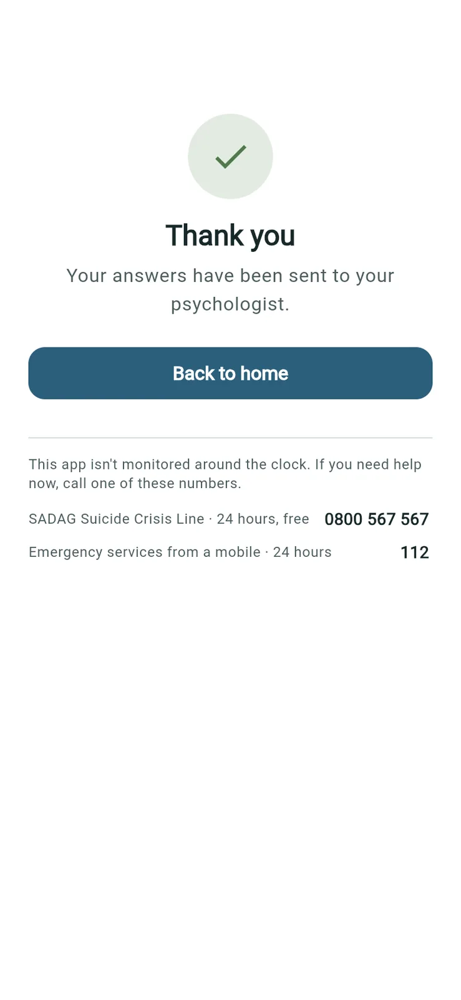

## An exercise

Breathing exercises guide them round by round. They can tap **Finish early**. You see that they finished it, and how long it took.

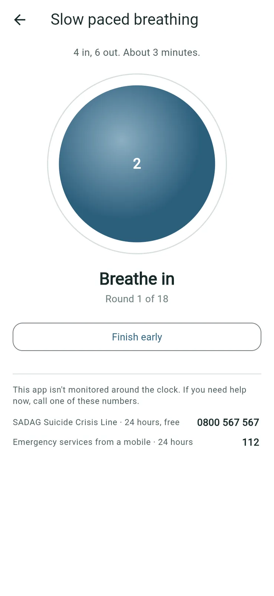

## Their check-ins

**See your check-ins** shows their own ratings over **2 weeks**, a **Month** or **3 months**, and each check-in with their words.

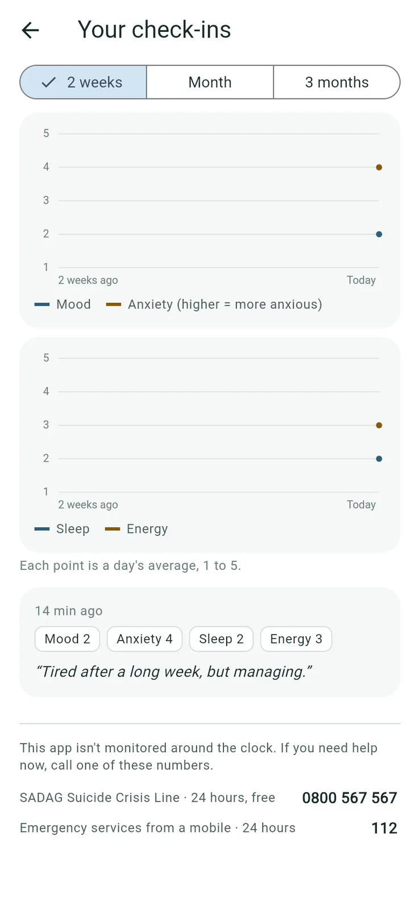

## Their settings

The gear on the home screen opens **Settings**:

- **Who sees what you send**: their psychologist, and anyone you've shared them with.
- **Change password**, and **Two-step sign-in**, which is optional for patients.
- **Lock Steady** (phone app only): asks for the phone's screen lock when they open Steady and after two minutes away. It's off unless they turn it on.
- **Stop sharing watch data**, if they've connected a watch.
- **Delete my account**.

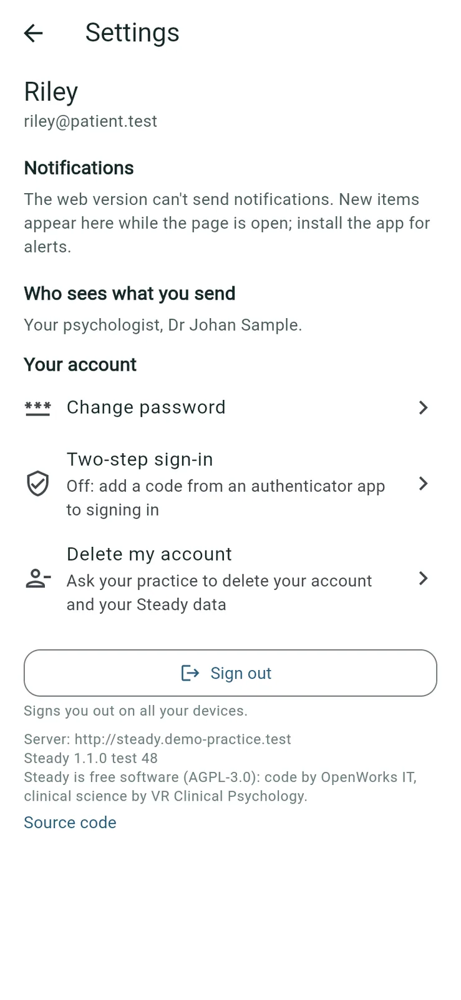

*(Lock Steady and connecting a watch exist only in the phone apps, so they aren't in these screenshots.)*

## Deleting their account

1. In **Settings**, the patient taps **Delete my account**.
2. Steady explains what happens and why the practice keeps clinical records (South African law requires it), and suggests talking to their psychologist first if things are hard.
3. They type **Your password** and tap **Ask to delete my account**.

   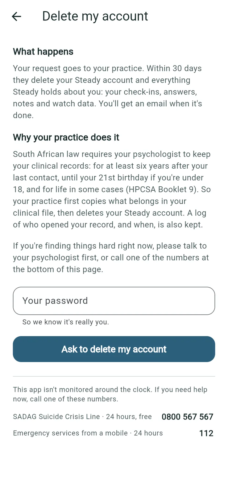

   

The request goes to their psychologist (see [When a patient asks to delete their account](#when-a-patient-asks-to-delete-their-account)). If they change their mind, they tell their psychologist.

## When the consent statement changes

If the practice's consent statement changes, patients see **Before you go on** the next time they open Steady, and agree to the new statement before carrying on.
